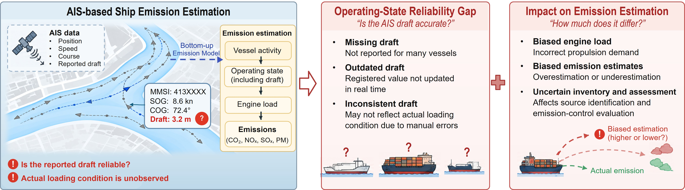
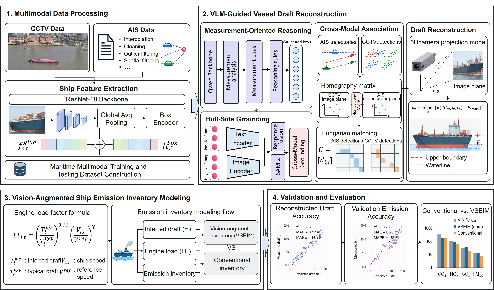

# VSEIM: Vision-Enhanced Ship Emission Inventory Modeling

A vision-language model-guided framework for reconstructing vessel operating draft and improving AIS-based ship emission inventories.

**Repository:** [Haven9834/VSEIM](https://github.com/Haven9834/VSEIM)

## Abstract

High-resolution ship trajectories do not necessarily guarantee reliable emission estimates. Automatic identification system (AIS)-based emission inventories rely on reported vessel draft to characterize loading conditions, yet discrepancies between reported and actual operating drafts can introduce substantial errors into emission calculations. To address this critical source of uncertainty, this study proposes a vision-language model (VLM)-guided framework that integrates visually reconstructed operating draft into a vision-enhanced ship emission inventory model (VSEIM). First, measurement-oriented visual reasoning identifies physically meaningful hull regions and structural boundaries, overcoming the limitations of conventional visual references under heterogeneous surveillance conditions. Second, semantic grounding and calibrated camera geometry enable metric freeboard measurement and vessel-specific operating draft reconstruction. Finally, the reconstructed draft is incorporated into bottom-up emission calculations, replacing uncertain AIS-based draft inputs while preserving the physical structure of conventional emission modeling. To evaluate the proposed framework, 16 h of synchronized CCTV–AIS data were collected from four monitoring areas along the Huangpu River. Results show that replacing the AIS-based draft with the reconstructed operating draft reduces the overall estimated emissions by 16.42%, with pollutant-specific reductions reaching 21.65%. The effects vary across pollutants and vessel types, with estimated CO₂ emissions decreasing by 16.46%. Independent validation using verified operating drafts from 13 passenger vessels further demonstrates the effectiveness of the proposed framework. Compared with the conventional approach, VSEIM reduces draft mean absolute error from 0.692 m to 0.197 m and decreases pollutant-specific emission mean absolute percentage errors from 9.35%–20.74% to 4.53%–6.14% relative to the verified-draft benchmark. These findings highlight the importance of accurately representing vessel operating conditions and demonstrate the potential of vision-language models to improve the reliability of AIS-based ship emission inventories.

## Research Motivation

Reported draft may be missing, outdated or inconsistent with a vessel's actual loading condition. This uncertainty propagates through propulsion-load estimation and affects both emission totals and source attribution.

*Fig. 1. Operating-state uncertainty in AIS-based emission inventories and its implications for engine-load estimation, emission calculations and source assessment.*

## Framework Overview

VSEIM links synchronized CCTV–AIS observations with vessel-specific geometric measurements. Visually reconstructed operating draft is introduced into the bottom-up emission calculation, and the resulting estimates are evaluated against a verified-draft benchmark.

*Fig. 2. Overall VSEIM workflow: multimodal data processing, VLM-guided draft reconstruction, emission inventory modeling, and validation. The plot panels illustrate the evaluation workflow schematically.*

## Code

The repository provides configurable modules for semantic reasoning, hull-side reconstruction, CCTV–AIS association, metric draft recovery, main-engine emission calculation and validation. It also includes tools for association visualization, hull-side panels and image selection.

~~~bash
python -m pip install .
python -m vesselviz --help
~~~

For local visual-model inference, install the optional dependencies and configure the required model checkpoints:

~~~bash
python -m pip install ".[vision]"
~~~

The Qwen-compatible API endpoint, model identifier and credential environment variable are configured locally. Camera calibration, measurement thresholds and emission-model parameters are supplied through the configuration templates.

## Data Availability

The complete dataset is scheduled for public release on December 31, 2027. Researchers seeking early access may contact us at haifding@polyu.edu.hk. Early access may be granted following communication and verification of compliance with applicable data security protocols.

